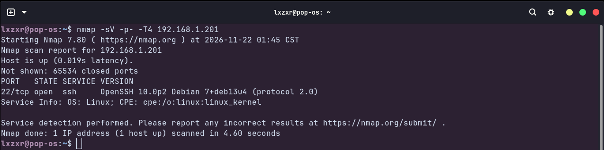
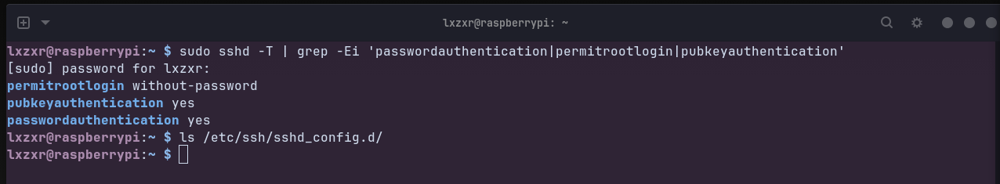
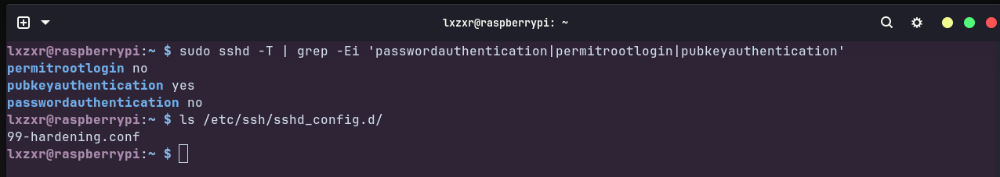
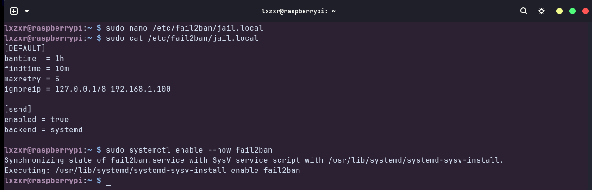
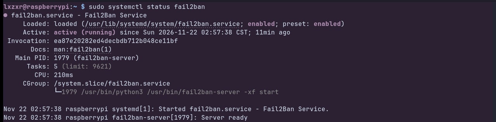
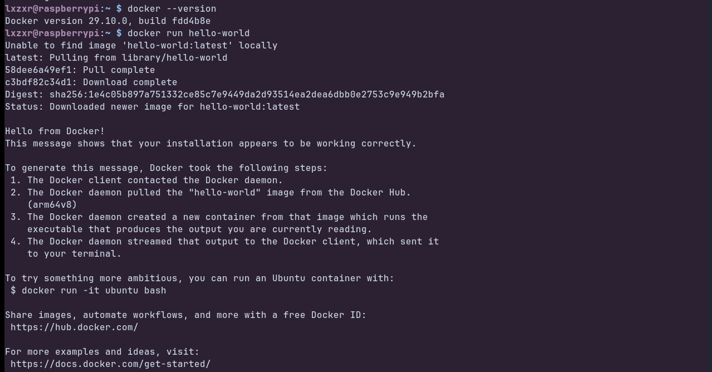

# pi-security-homelab
Raspberry Pi 5 security homelab: SSH Hardening, fail2ban, and Docker, building toward a Cowrie honeypot and Wazuh SIEM to detect and analyze attacks from my own test traffic.

> ** Disclaimer: ** All testing in this project is made on my own devices, on my home network. Nothing is exposed to the internet.

## Status

- [x] Raspberry Pi OS, networking through nmcli configuration, key-only SSH 
- [ ] fail2ban and Docker
- [ ] Cowrie SSH honeypot and test attacks
- [ ] Wazuh SIEM and agent
- [ ] write ups

## Lab Setup

| Device | Role | Notes |
| --- | --- | --- |
| Raspberry Pi 5 (8GB) | Target and sensor | Raspberry Pi OS Lite (64-bit), static IP |
| Pop!_OS PC | Admin and attacker machine | nmap, SSH client |

## Hardening the Pi 

### 1. Base system and networking

Installed Raspberry Pi OS Lite and updated it with 'sudo apt update && sudo apt upgrade'. My Starlink router doesn't support DHCP reservations, so I set static IPs on the Pi with the NetworkManager(nmcli).

## 2. Baseline scan (before hardening)

Scanned all ports from my PC after enabling SSH:

'''
nmap -sV -p- -T4 <(pi-ip)> -oN baseline-nmap.txt
'''

Result: port 22/tcp open (OpenSSH)

### 3. Key-based SSH 

Generated an ed25519 key pair on my PC and copied the public key to the Pi:

'''
ssh-keygen -t ed25519
ssh-copy-id <(user)>@<(pi-ip)>
'''

Confirmed key authentication with 'ssh-v', which reported 'Authenticated ... using "publickey"'.

### 4. Disabling password login

Created '/etc/ssh/sshd_config.d/99-hardening.conf':

'''
PasswordAuthentication no
PermitRootLogin no
PublicAuthentication yes
'''

Checked the config with 'sudo sshd -t', restarted with 'sudo systemctl restart ssh', and verified the effective settings with 'sudo sshd -T'.

| Setting | Before | After |
| --- | --- | --- |
| PasswordAuthentication | Yes | No |
| PermitRootLogin | without-password | No |

"without-root" is the legacy alias for "prohibit-password": root could log in over SSH with a key only, never a password. I set it to 'no' to block root SSH logins entirely, so any access has to go through a normal user and sudo.

Test: a login attempt with a key authentication disabled is now refused

## 5. fail2ban

Installed fail2ban and enabled the 'sshd' jail in '/etc/fail2ban/jail.local' (5 failed attempts within 10 minutes bans the source for 1 hour. My admin PC is whitelisted)

This is the configuration file created for fail2ban,
backend = systemd is needed beacuse current Raspberry Pi OS logs SSH to the systemd journal instead of to /var/log/auth.log

'''
sudo nano /etc/fail2ban/jail.local
'''

Ecpected output from the service status.

'''
sudo systemctl status fail2ban
'''

Expected output from the fail2ban-client status sshd

'''
sudo fail2ban-client status sshd
'''

## 6. Docker

Installed Docker with the official script and verified it with 'hello-world'. Displayed version.

## Troubleshooting log

-** 100% packet loss between the PC and the Pi.** The Pi's unplugged 'eth0' still had a lower-metric route for the local network, so traffic went out the dead interface instead of Wi-Fi. Bringing the wired connection down fixed it.

